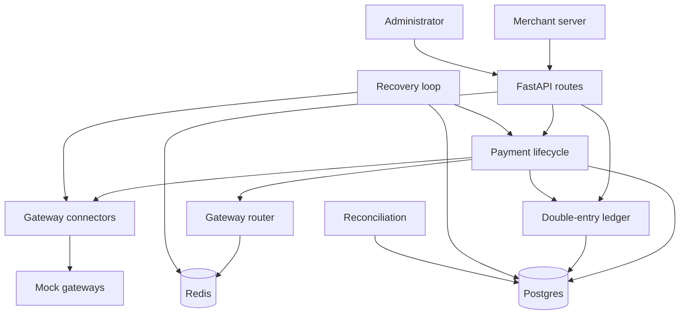
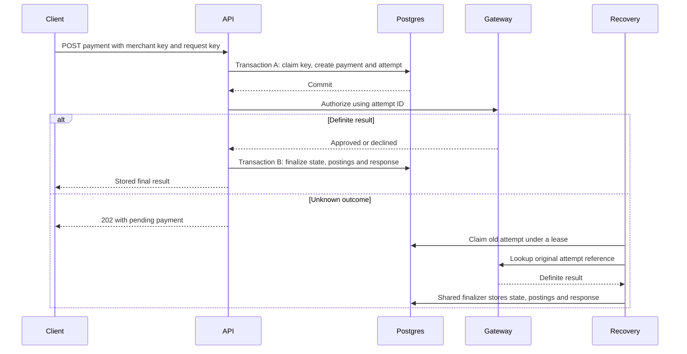

# Architecture and data model

PaySentry runs one FastAPI application, Postgres, Redis, and configurable mock gateways.
Postgres owns durable payment facts. Redis owns rate limits, gateway health, and routing statistics.

## Code boundaries

| Location | Responsibility |
| --- | --- |
| [app/main.py](../app/main.py) | App factory, resource startup, gateway clients, recovery task, shutdown |
| [app/config.py](../app/config.py) | Environment settings and gateway capability configuration |
| [app/db.py](../app/db.py) | Connection pool, JSON codec, migration runner and startup lock |
| [app/migrations/](../app/migrations) | Numbered schema changes. `001_initial.sql` holds tables, indexes, constraints, system accounts and the append-only ledger trigger |
| [app/auth.py](../app/auth.py) | Merchant keys, merchant identity, administrator authentication |
| [app/cards.py](../app/cards.py) | Card validation, brand detection, safe card fingerprint |
| [app/models.py](../app/models.py) | Validated request fields, amounts, currencies, reserved owner prefixes |
| [app/errors.py](../app/errors.py) | API errors, retry headers, validation response redaction |
| [app/idempotency.py](../app/idempotency.py) | Merchant request claim, fingerprint, stored response and replay header |
| [app/ledger.py](../app/ledger.py) | Transfer claim, account locking, funds checks and balanced postings |
| [app/payments.py](../app/payments.py) | Payment state machine, gateway orchestration and shared finalization |
| [app/recovery.py](../app/recovery.py) | Leased recovery of unknown or interrupted operations |
| [app/reconcile.py](../app/reconcile.py) | Consistent-snapshot checks across balances, entries, transfers and payments |
| [app/ratelimit.py](../app/ratelimit.py) | Atomic Redis token bucket per account or merchant |
| [app/routing.py](../app/routing.py) | Capability rules, circuit breakers, priority and success-rate ranking |
| [app/contextual.py](../app/contextual.py) | LinUCB features, scores, decay and atomic model observations |
| [app/connectors](../app/connectors) | Provider-specific requests and normalized outcomes |
| [app/routes](../app/routes) | HTTP parsing, authentication, rate limiting and response conversion |
| [app/demo.py](../app/demo.py) | Opt-in browser demo sessions, fixed payment actions and a per-session accounting snapshot |
| [app/static](../app/static) | Buildless demo page, styles and script |
| [gateway/app.py](../gateway/app.py) | In-memory mock payment processors with controllable failures |
| [tests](../tests) | API, accounting, concurrency, connector, recovery and routing checks |
| [scripts/simulate_routing.py](../scripts/simulate_routing.py) | Repeatable routing experiments on a dedicated database |

## Durable data

The schema is the field-level reference. These relationships explain how to read it.

| Table | Identity and relationships | Important rules |
| --- | --- | --- |
| `accounts` | UUID; owner and currency identify system and merchant accounts | Integer cached balance; ordinary accounts cannot go negative |
| `merchants` | UUID; unique API key hash | Secret key appears only in the create response; prefix is for display |
| `idempotency_keys` | Composite primary key `(merchant_id, key)` | Request hash, in-progress/completed state, original response and timestamps |
| `transfers` | UUID; unique idempotency key; two account foreign keys | Positive amount, distinct accounts, final result and response stored together |
| `ledger_entries` | Increasing integer ID; transfer and account foreign keys | Nonzero signed amount; updates and deletes rejected |
| `payments` | UUID; merchant foreign key | Authorized amount, capture/refund totals, state, gateway, pending operation and lease |
| `refunds` | UUID; payment foreign key | Pending amount reserves refundable funds; succeeded or failed is final |
| `payment_attempts` | UUID; payment foreign key | One authorization attempt at one gateway; attempt ID is the external request reference |
| `demo_sessions` | Token hash; unique merchant foreign key | One demo merchant per session; the raw cookie token is never stored |

Merchant and system owners have one account per currency through a partial unique index.
Merchant owners use `merchant:<uuid>`. System owners use `system:<name>`.
Other account owners do not have that uniqueness constraint.

`system:funding` offsets administrative top-ups.
`system:gateway_clearing` offsets captured and refunded card money.
These system accounts may go negative so each currency still nets to zero.
They represent accounting positions in the demo, rather than a bank settlement feed.

### Money movement

| Operation | Negative entry | Positive entry | Timing |
| --- | --- | --- | --- |
| Top-up | System funding | Target account | Inside the top-up transaction |
| Transfer | Source account | Destination account | Inside the posting transaction |
| Capture | Gateway clearing | Merchant account | When gateway capture is confirmed |
| Refund | Merchant account | Gateway clearing | When gateway refund is confirmed |
| Authorization or void | No entry | No entry | Holds live at the mock processor |

Amounts are positive request integers up to `10**12` minor units.
Supported currencies are `INR` and `USD`. Both use two decimal places in the mock contracts.
The API rejects strings, floats, zero, negative amounts, and unsupported currencies.
The per-request upper bound does not impose a lifetime cap on an account's accumulated balance.

### State and posting consistency

A payment's `amount_captured` cannot exceed its original amount.
Its `amount_refunded` cannot exceed the captured amount.
Some rules live in SQL constraints; others live in transaction logic and reconciliation.
For example, SQL alone does not enforce that every transfer has exactly two balancing entries.

Capture uses the posting key `payment-capture:<payment_id>`.
Refund uses `payment-refund:<refund_id>`.
These keys protect posting identity when competing finishers reach the same outcome.
They share the transfer key namespace with administrative transfers.
Administrative clients should avoid those internal prefixes.

## One payment across transaction boundaries

The request key survives an unknown outcome as `in_progress`.
A retry during that period returns `409 request_in_progress`.
After finalization, the same request returns the stored response.
The [payment design](design/payments.md) gives the complete transition table.

## Concurrency and ownership

Postgres serializes competing claims through unique constraints and row locks.
The payment row comes before its refund or attempt rows.
Account rows come last, in account ID order.
Plain transfers only lock accounts.

Pending captures and voids use conditional state updates.
Only an `authorized` payment can enter the matching pending state.
Refund creation locks the payment before computing captured minus refunded minus pending amounts.
Recovery claims old rows with `SKIP LOCKED`, bounded batches, and 30-second leases.
Finalizers check the pending state again after taking locks.

Payment reads and reconciliation use repeatable-read snapshots.
They therefore compare values from one database view while other payments commit.

## Redis data

| Key pattern | Data | Owner |
| --- | --- | --- |
| `ratelimit:<account or merchant>` | Tokens and refill timestamp, with expiry | Rate limiter |
| `routing:window:<gateway>` | Recent authorization outcomes | Router |
| `circuit:<gateway>` | Consecutive technical failures and open-until timestamp | Circuit breaker |
| `circuit:<gateway>:probe` | Exclusive temporary half-open probe | Circuit breaker |
| `routing:decisions` | Model decision clock | Contextual model |
| `routing:linucb:<gateway>` | Matrix, reward vector and last-update clock | Contextual model |

Lua scripts make each state update atomic across application instances.
Redis server time drives token buckets and circuit timing.
Routing falls back to configured priority when Redis is unavailable.
Rate limiting allows requests by default during Redis failure; configuration can make it reject them.
The health endpoint still reports Redis failure as unhealthy.

## Boundaries and limitations

The gateway mock keeps its state in process memory.
Restarting it loses authorization lookup records even if Postgres still holds payments.
With embedded demo gateways, the API rejects demo sessions created before its own boot for this reason.
Recovery is only as reliable as the provider's durable reference and idempotency contract.
The mock's promise that HTTP 503 means no processing is specific to these connectors.

At startup the app applies each file in `app/migrations/` that `schema_migrations` has not recorded, under an advisory lock.
Each migration commits with its record, so a failed one leaves the database at the last complete version.
Change the schema by adding a new numbered file; editing a shipped migration never reaches a live database.
Webhooks, a dashboard, real settlements, payouts, disputes, and live card processing are future work.
